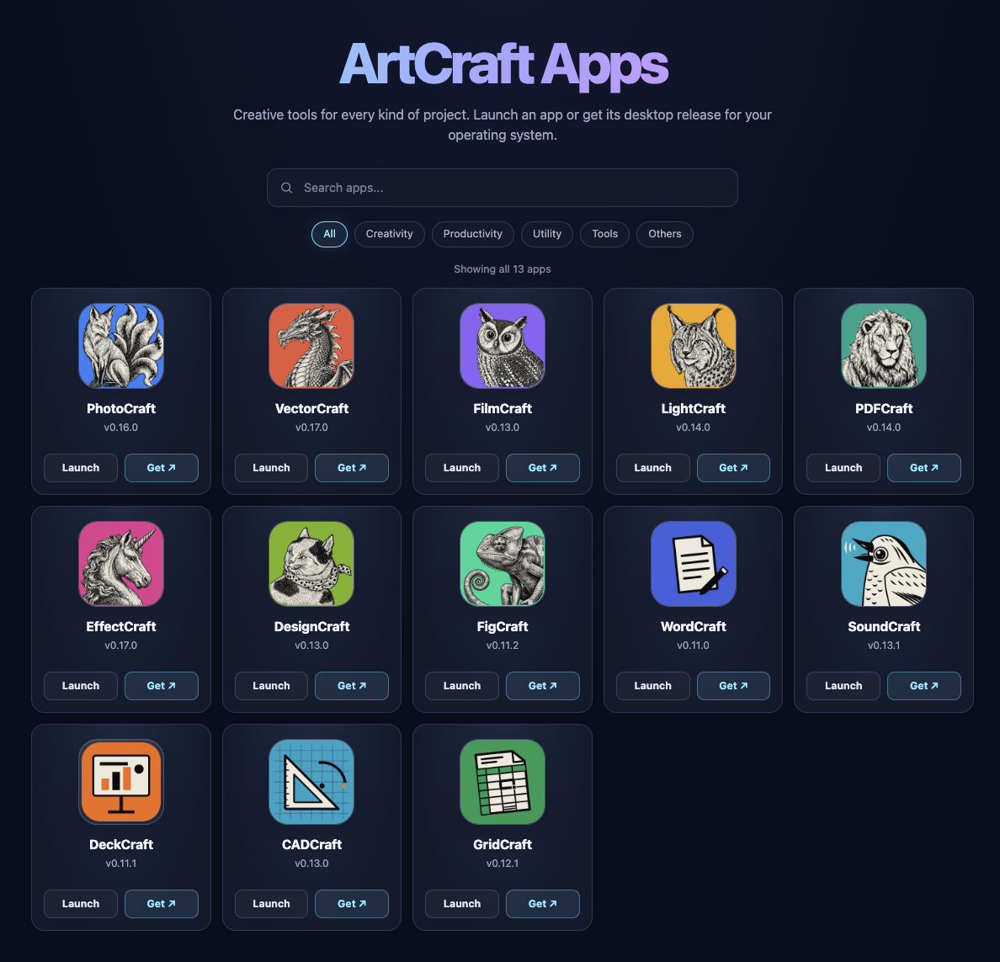

# AutoCraft --> ArtCraft Apps

[ArtCraft](getartcraft.com) is an open-source ecosystem of creative tools and software designed as a subscription-free alternative to traditional creative software suites and cloud-based AI tools.  It's built around the philosophy of avoiding recurring subscriptions, middlemen, or platform lock-in.  ArtCraft is releasing apps at a very fast pace, and if you want to test the latest version without first installing each app, then this is for you.

AutoCraft generates an up-todate web catalog for a collection of latest WASM builds of the ArtCraft apps that you can run entirely within your web browser--without installing anything. It provides links to launch each app in the browser and to download desktop releases.



## Features

- Browse the entire ArtCraft apps catalog, including: PhotoCraft, VectorCraft, FilmCraft, and GridCraft.
- Search apps and filter the catalog by category.
- Launch web versions or open the apps' GitHub release pages for desktop downloads.
- Switch between dark and light themes.

## What's included
- PhotoCraft & VectorCraft (Raster and vector graphics)
- FilmCraft & LightCraft (Video and lighting/color workflows)
- PdfCraft, WordCraft, & DeckCraft (Documents, text, and presentations)
- EffectCraft, DesignCraft, FigCraft, SoundCraft, CADCraft, & GridCraft (Specialized audio, layout, CAD, and effects tools)

## Build the catalog

The updater checks the `storytold` GitHub repositories for the latest web releases, downloads and extracts their ZIP assets, and generates the catalog from `index.html.template`.

Requirements: Python 3 and network access to the GitHub API and release assets.

```bash
python3 autocraft.py
```

The generated site is written to `/tmp/artcraft`. Once the updater finishes, serve it locally:

```bash
cd /tmp/artcraft
python3 -m http.server 8000
```

Open [http://localhost:8000](http://localhost:8000) in a browser. Stop the local server with `Ctrl+C`.

## Project files

- `autocraft.py` — downloads app web releases and generates the catalog page.
- `index.html.template` — source template for the generated catalog.
